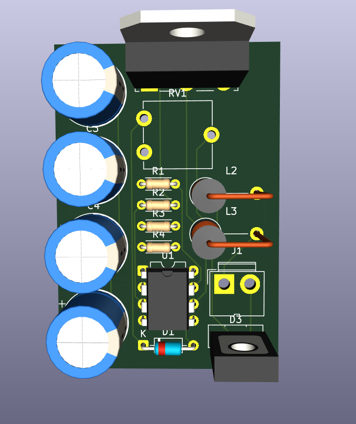
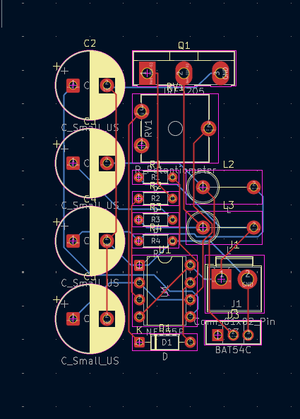
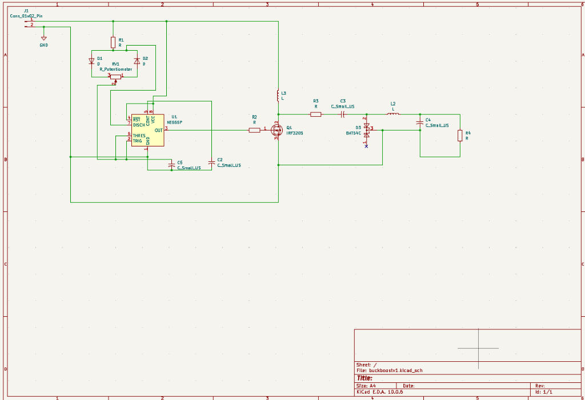
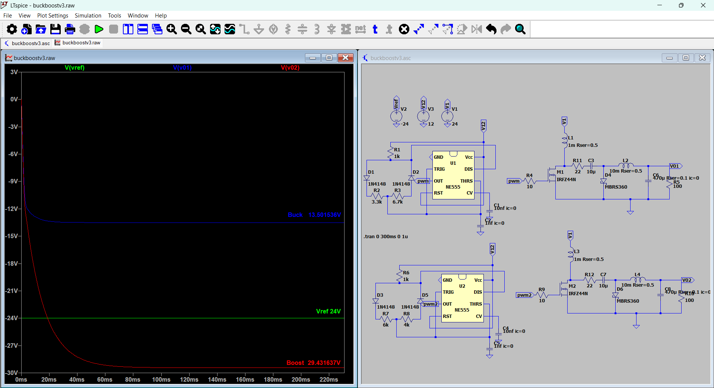

# Single-Stage Buck / Boost Demonstrator (555-timer PWM & KiCad PCB)

**Author:** Abhishek Rathour — B.Tech, Electrical & Electronics Engineering, NIT Goa

A complete power electronics project demonstrating **buck-mode (step-down) and boost-mode (step-up) behaviour from a single power-stage topology**, featuring both **LTspice simulation suites** and a physical **KiCad 10 hardware design & 2-layer PCB layout**.

---

## 📸 Hardware Previews

| Assembled 3D Board Render | KiCad 2-Layer PCB Layout |
|:---:|:---:|
|  |  |
| *3D view showing electrolytic cap bank, TO-220 MOSFET heatsink, NE555P, trimmer pot & inductors* | *2-layer routed board (`buckboostv1.kicad_pcb`)* |

### KiCad Schematic Diagram

*Complete hardware schematic (`hardware/buckboostv1.kicad_sch`) with NE555P astable PWM generator, potentiometer duty-cycle steering, and dual-inductor SEPIC power stage.*

---

## ⚡ What this is

A unified simulation and hardware project demonstrating how a single power stage behaves as either a **buck converter** (output below $V_{in}$) or a **boost converter** (output above $V_{in}$), purely by controlling the PWM switch duty cycle:

- **Duty cycle $D < 50\%$** $\longrightarrow$ Buck mode (step-down magnitude).
- **Duty cycle $D > 50\%$** $\longrightarrow$ Boost mode (step-up magnitude).

The repository documents the complete engineering trail:
1. **LTspice Simulation Trail:** Diagnosing inverting-topology issues, migrating to a two-inductor SEPIC stage, solving ripple current via switching frequency vs. duty-cycle moderation, and isolating the 555 supply rail.
2. **KiCad Hardware Implementation (`buckboostv1`):** Translating the simulation into a physical, manufacture-ready 2-layer PCB with a single potentiometer (`RV1`) for continuous, real-time duty cycle tuning on the lab bench.

---

## 🗂️ Repo Structure

```
├── hardware/
│   ├── buckboostv1.kicad_pro        # KiCad 10 project definition
│   ├── buckboostv1.kicad_sch        # Hardware schematic
│   ├── buckboostv1.kicad_pcb        # 2-layer routed PCB layout
│   ├── schematic.pdf                # High-res vector PDF export
│   ├── buckboostv1.svg              # Scalable vector graphics export
│   ├── bom.csv                      # Full Bill of Materials
│   ├── README.md                    # Hardware & PCB fabrication guide
│   └── gerbers/                     # Production Gerbers & NC drill files (JLCPCB/PCBWay)
├── ltspice/
│   ├── v1_sepic_fast_switching/     # Two-inductor power stage, 131 kHz switching
│   ├── draft1_555_vcc_isolation_test/ # Standalone 12V 555 testbench
│   └── v3_final/                    # Converter with dedicated 12V rail, 13.1 kHz
├── docs/
│   ├── 01-topology-and-goal.md      # Dual-mode operation & diode-steered 555 astable
│   ├── 02-v1-sepic-fast-switching.md
│   ├── 03-draft1-vcc-isolation-test.md
│   ├── 04-v3-final-fixes.md
│   ├── 05-hardware-kicad-pcb.md     # Detailed hardware & PCB design notes
│   ├── hardware/                    # Board renders and layout screenshots
│   └── v3_simulation_result.png     # LTspice waveform verification
├── CHANGELOG.md                     # Revision history
├── LICENSE                          # MIT License
└── README.md
```

---

## 🛠️ Hardware & PCB Design Details

### Continuous Duty Cycle Tuning via Potentiometer `RV1`
In physical hardware, fixed resistors are replaced by a **10kΩ vertical trimmer potentiometer (`RV1`)** coupled with antiparallel steering diodes `D1` and `D2`:
- Turning `RV1` clockwise increases charging resistance $\rightarrow$ **Duty cycle $D > 50\%$ (Boost)**.
- Turning `RV1` counter-clockwise increases discharge resistance $\rightarrow$ **Duty cycle $D < 50\%$ (Buck)**.
- A single knob controls real-time continuous transitions from step-down to step-up.

### Key Hardware Components
| Reference | Part | Package | Role |
|---|---|---|---|
| **U1** | NE555P | DIP-8 | High-precision PWM astable oscillator |
| **Q1** | IRF3205 | TO-220 / TO-218 | 55V, 110A, 8mΩ N-Channel power MOSFET |
| **RV1** | Potentiometer | ACP CA9-V10 | Real-time duty-cycle adjustment |
| **D1, D2** | 1N4148 / DO-35 | Axial | Independent charge/discharge steering diodes |
| **D3** | BAT54C / Schottky | TO-126-3 | Ultra-fast freewheeling diode |
| **L2, L3** | Power Chokes | Fastron MECC Axial | Energy storage dual inductors |
| **C2-C5** | Radial Electrolytic | D10mm, P5mm | Low-ESR AC coupling, filter & timing caps |
| **J1** | 2-Pin Terminal | JWT A3963 | DC power input connector |

Fabrication Gerbers and drill files are located in [`hardware/gerbers/`](hardware/gerbers/). See [`hardware/README.md`](hardware/README.md) for manufacturing guidelines.

---

## 📊 Simulation Summary (LTspice)

| Parameter | v1 | Draft1 | v3 (Final) |
|---|---|---|---|
| **Power stage** | SEPIC-style, 2 inductors | *(none — timer only)* | SEPIC-style, 2 inductors |
| **Switching frequency** | 1nF $\rightarrow$ **~131 kHz** | 10nF $\rightarrow$ ~9.3 kHz | 10nF $\rightarrow$ **~13.1 kHz** |
| **Duty cycle (2 channels)** | 27.3% / **81.8%** | 29.5% (single channel) | **39.1% / 63.6%** |
| **Inductor ripple current** | ~0.5 A / ~1.5 A | n/a | ~0.7 A / ~1.2 A |
| **555 Vcc** | Shared 24V rail ⚠️ | **Dedicated 12V** ✅ | **Dedicated 12V** ✅ |
| **Coupling-cap damping** | none | n/a | 22 Ω (`R11`/`R12`) |
| **Output-cap ESR** | none | n/a | modeled (`Rser = 0.1Ω`) |

### Verification Waveforms (v3)


With input $V_{ref} = 24\,\text{V}$:
- **Buck Channel (`U1`, $D = 39.1\%$):** Output settles at **$13.50\,\text{V}$** (step-down confirmed).
- **Boost Channel (`U2`, $D = 63.6\%$):** Output settles at **$29.43\,\text{V}$** (step-up confirmed).

---

## 💻 How to Open the Design Files

- **KiCad Design Files:** Open [`hardware/buckboostv1.kicad_pro`](hardware/buckboostv1.kicad_pro) in **KiCad 10** (or 8 / 9). All footprints, schematic symbols, and 3D models use standard KiCad libraries.
- **LTspice Simulations:** Open any `.asc` file in [`ltspice/`](ltspice/) using free LTspice (Windows, macOS, or Wine on Linux). Built-in generic models are used throughout.

---

## 📜 License

MIT License — see [LICENSE](LICENSE).
